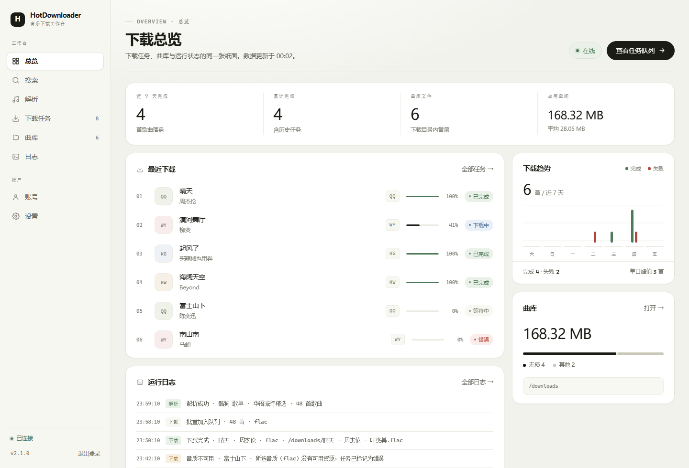
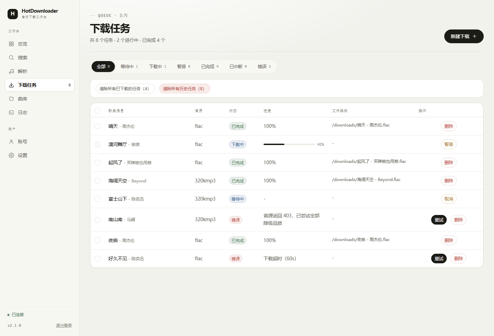
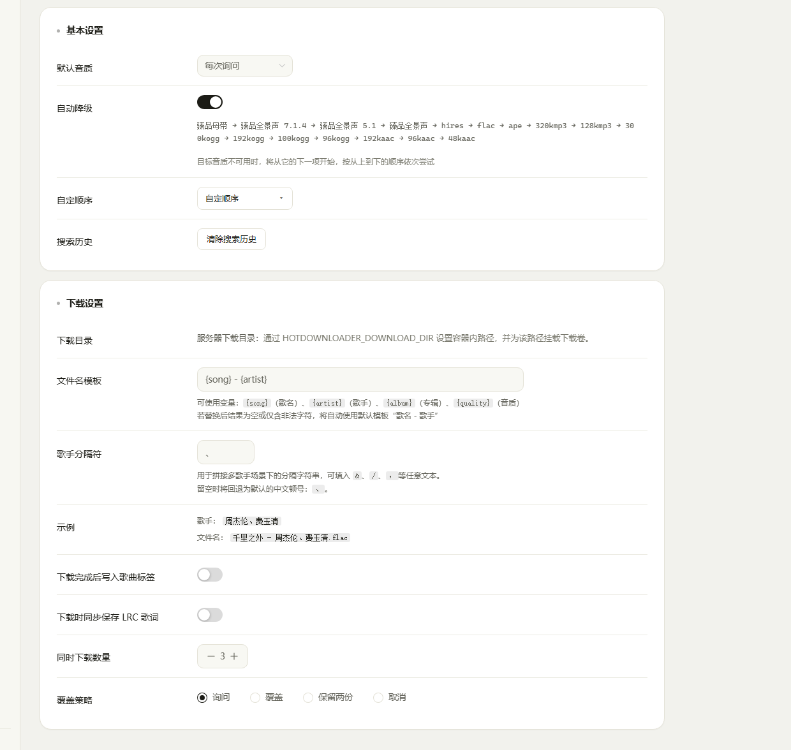

# 🎵 HotDownloader-docker

> 基于原项目 [lerdb/HotDownloader](https://github.com/lerdb/HotDownloader)
> 保留上游共享 Rust 下载核心与 Vue 3 前端，**Docker 部署**。


---

## 🏗️ 架构（单镜像 / 单容器）

Rust 服务同时托管 Web 页面与 API，浏览器只访问一个端口，无需 nginx，也无需分别部署 web / server。

```
                   浏览器
                      │ HTTP
                      ▼
        ┌──────────────────────────────────┐
        │  HotDownloader（单容器 :8787）     │
        │                                  │
        │  Rust 服务（crates/hotdownloader-server）
        │    ├── /             → Web 静态资源 (dist)
        │    ├── /api/music/*  → 搜索/歌单/专辑/歌手/歌词
        │    ├── /api/tasks*   → 任务创建/暂停/恢复/删除/重试
        │    ├── /api/settings → 设置（字段级合并）
        │    ├── /api/logs     → 运行日志（服务端）
        │    ├── /api/login/*  → 扫码/手动登录
        │    ├── /api/qishui/* → 汽水 Cookie / 签名器状态
        │    ├── /api/events   → SSE 任务/设置实时推送
        │    └── /healthz      → 健康检查
        │                                  │
        │  共享核心（crates/hotdownloader-core）│
        │    · 下载引擎（并发/断点续传/降级）  │
        │    · 平台实现       │
        └──────────────────────────────────┘
                      │
                      ▼
                 /data  /downloads
```

- **后端**：`crates/hotdownloader-core`（共享核心）+ `crates/hotdownloader-server`（HTTP/SSE 服务），与上游 v2.0.0 保持一致。
- **前端**：Vue 3 + Naive UI，「温石纸面」浅色主题（`src/style.css`、`src/config/theme.ts`、`src/components/NavLayout.vue`）；解析/下载/连接事件写入独立日志页（`src/stores/logStore.ts`、`src/views/LogView.vue`）。
- **访问认证**：对外监听时必须设置用户名密码或令牌（见下）。

---
| 总览 | 下载任务 | 搜索 | 曲库 |
| --- | --- | --- | --- |
|  |  |  |  |

| 日志 | 账号 | 设置 | 登录 |
| --- | --- | --- | --- |
|  |  |  |  |

## 🆕 界面与交互更新

- **接入汽水音乐**：分享链接（含 `qishui.douyin.com` 短链）解析歌名、封面、逐字歌词；免费曲目可下整曲，会员曲目要「会员账号 + 应用签名」才能拿全。Web 端只做解析与试听/3 档 AAC —— 关键词搜索必须签名，已从搜索页移除，改由 agent/MCP 承担。详见下文「汽水音乐：会员整曲与签名」。
- **全新「纸面」视觉**：暖灰画布 + 纯白卡片 + 近黑主操作，统一圆角、细描边与等宽数字，去掉花哨渐变。
- **总览页重做**：四格关键指标、近 7 天完成/失败趋势细柱图、最近下载列表与曲库构成。
- **独立日志页**：解析、下载、账号、连接事件统一留痕，可按「解析 / 下载 / 仅失败」筛选，**只保留最近 200 条**，超出自动丢弃；日志由服务端环形缓冲保存到 `/data/logs.json`，换设备、清缓存或更换访问端口后仍在（桌面端没有独立服务，仍写本机）。
- **任务列表最新在前**：新加入的任务永远排在列表顶部，各状态标签一致生效。
- **下载不再打断操作**：移除「添加任务后跳转至任务页」开关，下载后停留在当前页面继续挑歌。
- **品牌标识统一**：站点图标、侧栏与登录页统一为 H 标记，Web 访问页重排为纸面卡片。

---

## 🚀 Docker 部署（推荐）

前置要求：Docker ≥ 24、Docker Compose v2。

### 1. 获取源码

```bash
git clone https://github.com/adaier1/hotdownloaderdocker.git
cd hotdownloaderdocker
```

### 2. 登录凭据

**默认账号：`admin` / `admin123`**。登录后可在 **设置 → 安全设置 → 修改密码** 中修改，
结果保存到 `/data/auth.json`，重启后仍然有效。

### 3. Compose

```bash
services:
  hotdownloader:
    image: ghcr.io/adaier1/hotdownloaderdocker:latest
    container_name: hotdownloader
    restart: unless-stopped

    ports:
      - "8080:8787"

    environment:
      HOTDOWNLOADER_BIND: "0.0.0.0:8787"
      HOTDOWNLOADER_DATA_DIR: "/data"
      HOTDOWNLOADER_WEB_DIR: "/app/dist"
      HOTDOWNLOADER_DOWNLOAD_DIR: "/downloads"

      AUTH_USERNAME: "admin"
      AUTH_PASSWORD: "admin123"

      TZ: "Asia/Shanghai"
      RUST_LOG: "info"

    volumes:
      - ./data:/data
      - ./downloads:/downloads
```

### 4. 访问

打开浏览器访问 **http://<主机IP>:8080**，使用默认账号 **`admin` / `admin123`**

### 环境变量

| 变量 | 默认值 | 说明 |
| --- | --- | --- |
| `HOTDOWNLOADER_BIND` | `0.0.0.0:8787` | 服务监听地址（容器内） |
| `HOTDOWNLOADER_DATA_DIR` | `/data` | 数据目录（任务/设置/凭据） |
| `HOTDOWNLOADER_WEB_DIR` | `/app/dist` | Web 静态资源目录 |
| `HOTDOWNLOADER_DOWNLOAD_DIR` | `/data/downloads` | 音乐下载目录（compose 中设为 `/downloads`） |
| `AUTH_USERNAME` / `AUTH_PASSWORD` | `admin` / `admin123` | 初始用户名密码（仅 `auth.json` 不存在时生效） |
| `HOTDOWNLOADER_TOKEN` | 空 | 令牌认证（≥16 字符，与用户名密码二选一） |
| `RUST_LOG` | `info` | 日志级别 |
| `WEB_PORT` | `8080` | 宿主机端口（compose） |
| `DATA_PATH` | `./data` | 宿主机数据目录（compose） |
| `DOWNLOAD_PATH` | `./downloads` | 宿主机下载目录（compose） |
| `TZ` | `Asia/Shanghai` | 时区（compose） |

### 持久化文件

| 路径 | 内容 |
| --- | --- |
| `/data/settings.json` | 用户设置 |
| `/data/tasks.json` | 下载任务 |
| `/data/auth.json` | 访问账号密码（界面修改密码后写入） |
| `/data/mcp.json` | MCP 接入密钥（设置页可重置） |
| `/data/shortcut.json` | 快捷指令密钥（设置页可重置） |
| `/data/notify.json` | 通知配置（飞书 FSKEY） |
| `/data/qq-credentials.json` | QQ 音乐登录凭据 |
| `/downloads/` | 下载的音乐文件 |

> 从旧版 Web 版（axum `/api/invoke`）升级：旧 `/data/data.json` 不会自动读取。可将其中的 `settings`、`tasks` 字段分别写成 `settings.json`、`tasks.json`（旧任务记录字段与 v2.0.0 兼容）。搜索历史为浏览器本地数据，存于 `localStorage`。

---

## 🎧 汽水音乐：会员整曲与签名

前置：要拿会员整曲或做汽水搜索，需要在装有汽水客户端的 Windows 上准备 Node 22（或让客户端自带 Electron 顶替）；只做分享链接解析则不需要任何额外依赖。

三条容易误解的事实：

1. **没有网页版**：`www.qishui.com` 只是下载落地页，分享 H5 也没有登录入口，所以 Cookie 只能从桌面客户端的库文件里读；
2. **Cookie 不等于能用**：搜索、`hi_res`/`spatial` 档位、会员曲整曲还要 `x-helios`/`x-medusa` 应用签名，而签名只能由客户端里的 `bdms.node`（Windows 原生插件）生成；
3. **签名不改变曲目权限**：会员曲目 60 秒试听是账号问题，不是签名问题。

缺签名时服务端的响应是 **`HTTP 200` + 空 body**，所以搜索看起来像「没有结果」、取流看起来像「该音质不可用」。

### 三种部署形态

| 形态 | 签名从哪来 | 适用 |
| --- | --- | --- |
| A. 服务也跑在 Windows（不经 Docker） | 进程内调本机 `bdms.node`（`mode: local`） | 单机自用，最省事 |
| B. Docker + 宿主机签名服务 | 容器通过 `QISHUI_SIGNER_URL` 调宿主机（`mode: remote`） | 局域网/家用服务器，想要完整搜索与高音质 |
| C. 公网 Docker + 本机解析（直链投递） | 服务端**不需要**签名 | 公网部署，服务端零凭据 |

### 形态 B：宿主机签名服务

签名服务跑在装有汽水客户端的 Windows 上，容器通过 `host.docker.internal` 调它：

```bash
# 宿主机
QISHUI_SIGNER_TOKEN=<自定义token> node scripts/qishui-signer-server.mjs
# 监听 0.0.0.0:8899；GET /config 给设备身份，POST /sign 出 x-helios / x-medusa
```

`.env`（`docker-compose.yml` 已透传）：

```
QISHUI_SIGNER_URL=http://host.docker.internal:8899/sign
QISHUI_SIGNER_TOKEN=<与上面一致>
```

- 这个终端**必须保持在线**，关掉后只会静默退化（搜不到、档位变少），不会报错；
- 公网服务器上 `host.docker.internal` 无效，需换成隧道地址（Tailscale / Cloudflare Tunnel），并且**必须走 HTTPS 或私有网络**——签名请求里带 Cookie；
- 状态自查：`GET /api/qishui/signer` 返回 `{"available":true,"mode":"remote"}` 即正常。

### 形态 C：本机解析 + 直链投递（服务端零签名、零 Cookie）

在能签名的机器上一次性解析出 CDN 直链，随任务投给服务器：

```bash
python scripts/qishui_stream.py <track_id>
# {"url":"https://…","playAuth":"…","filename":"320.m4a","size":8414936,"expiresAt":0}
```

把这段 JSON 作为 `create_download_task` 的 `stream` 参数（MCP）或 `POST /api/tasks` 的 `stream` 字段即可，服务器只负责下载与解密。

- 脚本用 `node -e` 调一次 `bdms.node` 就退出，**不需要常驻服务**；
- 优先选 `hi_res` / `highest`，`spatial` 的地址在无 Cookie 的机器上会被降级；
- 直链带 `expire`，过期任务会直接标错，需要重新解析。

### 常见问题

| 现象 | 结论 |
| --- | --- |
| 解析页只有 320/128/64 三档 | 没有签名（或没装客户端），不是解析失败 |
| 搜索汽水返回空 | 已从 Web 搜索页移除；需 agent + 签名，或改用分享链接 |
| 会员曲目只有 60 秒 | 账号不是会员，签名不影响权限 |
| 昨天能用今天不行 | Cookie 过期（`sid_guard`），重跑 `scripts/qishui_login.py client --mcp` |

> 从客户端读 Cookie 的完整流程（含 Windows/macOS 路径、签名器探测、自检脚本）见仓库内技能文档 `skills/hotdownloader/references/qishui.md`。

---

## ⚡ 快捷指令（iOS 捷径 / 脚本）

把分享链接交给手机上的「分享 → 运行捷径」，服务端解析后**直接创建下载任务**，不需要打开网页逐首确认。
入口在 **设置 → 快捷指令**（Web 版），可复制调用地址、重置 Key。

### 调用地址

```
http://<主机IP>:8080/api/shortcut/parse?key=<密钥>&url=<URL 编码后的分享链接>
```

- 只接受 `GET`，其它方法返回 `405`。
- `key` 由服务端生成并保存在 `/data/shortcut.json`，点击「重置 Key」后旧地址立即失效。
- 该接口用 `key` 认证，**不经过用户名密码**，所以这条地址等同于凭据，别发到群里或截图外传。

### 参数

| 参数 | 必填 | 说明 |
| --- | --- | --- |
| `key` | 是 | 快捷指令密钥，见设置页 |
| `url` | 是 | 分享链接或整段分享文案，需整体 URL 编码（`:` `/` `?` `&` 都要转义） |
| `limit` | 否 | 单次最多创建的任务数，默认 `20`，范围 `1–100` |

### 返回

```json
{
  "ok": true,
  "message": "已创建 12 个下载任务",
  "platform": "qqmusic",
  "kind": "playlist",
  "total": 48,
  "createdCount": 12,
  "failedCount": 0,
  "songs": [{ "taskId": "…", "title": "晴天", "artist": "周杰伦", "quality": "flac" }],
  "failed": []
}
```

- `message` 可以直接放进通知或弹窗；`songs` 是已创建的任务（带 `existing: true` 表示命中已有任务，没有重复建单）。
- 音质遵循设置里的「默认音质」；该档不可用时按任务规则自动降级。设置为「每次询问」时，取该曲最高可用音质（捷径没有选择界面）。
- 重名文件自动「保留两份」，不会停在确认弹窗上。

### iOS 捷径搭建

1. 新建捷径，接收分享表单的 `URL`（或用「获取剪贴板」）。
2. 添加「URL 编码」动作，把分享链接编码。
3. 添加「获取 URL 内容」：
   - 地址：`http://<主机IP>:8080/api/shortcut/parse?key=<密钥>&url=` 拼接第 2 步结果
   - 方法：`GET`
4. 添加「获取字典值」，取 `message`，再用「显示通知」或「显示提醒」输出结果。

命令行验证：

```bash
curl "http://127.0.0.1:8080/api/shortcut/parse?key=<密钥>&url=https%3A%2F%2Fy.qq.com%2Fn%2Fryqq%2Fplaylist%2F123456"
```

---

## 🤖 MCP（Model Context Protocol）

服务在**同一个端口**上额外提供 MCP Streamable HTTP 入口，供支持 MCP 的 AI 客户端调用；它独立于原有 Web/API，不影响既有功能、Docker 单镜像与上游核心。

- 端点：`POST /mcp`（JSON-RPC 2.0；通知类消息返回 202，其它方法返回 405）
- 设置页：**设置 → MCP 接入 → MCP 接入配置**，可查看/复制带密钥的完整链接并重置密钥（密钥存于 `/data/mcp.json`）
- 认证：二选一
  - URL 携带密钥：`http://<主机IP>:8080/mcp?key=<密钥>`
  - 请求头：`Authorization: Basic base64(用户名:密码)`，或 `Authorization: Bearer <HOTDOWNLOADER_TOKEN>`（令牌模式）

提供的工具（共 33 个）：

- 搜索：`search_songs`、`search_albums`、`search_artists`、`search_playlists`、`fetch_album_songs`、`fetch_artist_songs`、`fetch_artist_albums`、`fetch_playlist_songs`、`fetch_hot_keywords`、`fetch_suggestions`、`get_lyric_by_id`
- 解析：`parse_link`（任意平台分享链接/文案 → 歌曲或歌单，结果可直接建任务）
- 任务：`list_tasks`、`create_download_task`（支持 `stream` 直链：由能签名的机器解析好后投递，服务端不再请求平台接口）、`pause_task`、`resume_task`、`retry_task`、`remove_task`、`remove_tasks`
- 设置：`get_settings`、`patch_settings`、`get_default_download_dir`、`get_login_status`
- 曲库：`list_library`、`delete_library_files`、`rename_library_file`、`write_library_metadata`
- 账号：`list_accounts`、`start_qr_login`、`check_qr_login`、`save_cookie`、`login_with_credentials`、`logout_account`

### 账号：在对话里扫码登录 / 写 Cookie

MCP 侧的登录流程与网页一致，但二维码是**直接作为图片返回**的，可以原样转发到聊天窗口让用户扫：

1. `start_qr_login`（`platform` = `qqmusic` / `netease` / `kugou`）→ 返回 PNG 图片内容、`sessionId`、`imagePath`、`imageUrl`（`/api/login/qr-image/<platform>.png`，需与 `/mcp` 相同的认证头）。
2. 用户用手机 App 扫码；期间每 2 秒调一次 `check_qr_login`（`platform` + `sessionId`），状态依次是 `waiting` → `scanned` → `confirmed`，`done: true` 时停止。
3. `confirmed` 时凭据已自动写入（QQ 的扫码接口只回传令牌，MCP 负责落库），随后搜索/下载立即带登录态。

其它入口：

- `save_cookie`：把浏览器复制的 Cookie 直接写入网易云或汽水（汽水未配置 Cookie 时搜索不可用）。
- `login_with_credentials`：QQ 用 `uin` + `authst`，酷狗用 `userid` + `token`，适合已经有令牌的场景。
- `list_accounts` / `logout_account`：查看四个平台登录态、退出登录。

> 二维码图片固定写在数据目录的 `qr/<platform>.png`，重复扫码只覆盖旧图；有效期约 3 分钟（酷狗 5 分钟），过期后重新调用 `start_qr_login`。


客户端配置示例（远程 HTTP，推荐直接用设置页生成带密钥的链接）：

```json
{
  "mcpServers": {
    "hotdownloader": {
      "type": "http",
      "url": "http://<主机IP>:8080/mcp?key=<设置页中的密钥>"
    }
  }
}
```

也可用请求头方式（将 `用户名:密码` 做 Base64）：

```json
{
  "mcpServers": {
    "hotdownloader": {
      "type": "http",
      "url": "http://<主机IP>:8080/mcp",
      "headers": { "Authorization": "Basic <base64(用户名:密码)>" }
    }
  }
}
```

---

## 🧩 配套 Skill（让 agent 按套路用起来）

仓库里带了一份 **agent 使用手册**：`skills/hotdownloader/`。它不是插件、不改运行逻辑，而是把「怎么搜索、怎么解析、怎么建任务、平台差异、排错」固化成 Agent Skill，让 Claude / Codex / WorkBuddy 这类客户端不需要每次重新摸索。

```
skills/hotdownloader/
├── SKILL.md              入口：搜索 / 解析 / 下载 / 任务 / 账号 / 排错
├── INSTALL.md            安装说明（给 agent 照着执行 / 也给人看）
└── references/
    ├── qishui.md         汽水专项（客户端 Cookie、签名、直链投递）
    └── signer.md         签名与 App 端请求契约
```

它调用的能力就是本文档里的 MCP 工具与 `/api/*` 接口，配套脚本在仓库 `scripts/` 下：

| 脚本 | 用途 |
| --- | --- |
| `scripts/qishui_login.py` | 从本机汽水客户端读 Cookie 并落库 |
| `scripts/qishui_doctor.py` | 六项环境自检（系统 / MCP / 客户端 / Cookie / 签名 / 应用状态） |
| `scripts/qishui_stream.py` | 一次性解析汽水直链（喂给 `stream`，无需常驻服务） |
| `scripts/qishui-signer-server.mjs` | 宿主机签名服务（供容器调用） |

### 安装

**方式 0：让 agent 自动安装（最省事）**

把下面这段直接复制发给你的 agent，它会照着 `INSTALL.md` 完成下载、复制与校验：

```
Copy the prompt below and send it to your Agent to perform automated installation:

请按这个说明，为我安装 hotdownloader Skill：
https://raw.githubusercontent.com/adaier1/hotdownloaderdocker/main/skills/hotdownloader/INSTALL.md
```

安装说明本身也在这个文件里（可当成人看的步骤）：<https://github.com/adaier1/hotdownloaderdocker/blob/main/skills/hotdownloader/INSTALL.md>

**方式一：项目级（跟随仓库）**

```bash
git clone https://github.com/adaier1/hotdownloaderdocker.git
cd hotdownloaderdocker
mkdir -p .workbuddy/skills
cp -r skills/hotdownloader .workbuddy/skills/
```

**方式二：用户级（所有项目都能用）**

```bash
cp -r skills/hotdownloader ~/.workbuddy/skills/          # macOS / Linux
# Windows: xcopy skills\hotdownloader %USERPROFILE%\.workbuddy\skills\hotdownloader /E /I
```

**方式三：直接下载**（不想 clone 时）

- 目录浏览：<https://github.com/adaier1/hotdownloaderdocker/tree/main/skills/hotdownloader>
- 单文件：<https://raw.githubusercontent.com/adaier1/hotdownloaderdocker/main/skills/hotdownloader/SKILL.md>

装好后对 agent 说一句「用 hotdownloader 技能帮我在服务端解析这条网易云链接并下载」即可；技能会自动先跑自检、判断平台登录态，再决定走 MCP 还是 HTTP。

> 触发词：HotDownloader 怎么用、搜索歌曲、解析分享链接、建下载任务、汽水音乐、QQ音乐链接、网易云链接。

---

## 🔔 通知设置（飞书机器人）

在 **设置 → 通知设置** 中配置：

- **启用飞书通知**：开关，开启后任务完成/失败时推送。
- **FSKEY**：飞书自定义机器人的 FSKEY（也可直接粘贴完整 Webhook 地址）。
- **发送测试**：保存配置并立即发送一条测试消息，用于验证。

获取 FSKEY：飞书群 → 设置 → 群机器人 → 添加「自定义机器人」，Webhook 形如
`https://open.feishu.cn/open-apis/bot/v2/hook/<FSKEY>`，其中 `<FSKEY>` 即所需值。

---

## 🛠️ 本地开发

```bash
# 1) 启动独立服务（默认监听 127.0.0.1:8787）
HOTDOWNLOADER_BIND=0.0.0.0:8787 \
HOTDOWNLOADER_DATA_DIR=/tmp/hd-data \
HOTDOWNLOADER_WEB_DIR=./dist \
cargo run --manifest-path crates/hotdownloader-server/Cargo.toml

# 2) 启动前端开发服务器（vite 会把 /api 代理到服务）
npm install
npm run dev
```

---


## 📄 许可证

本项目基于 [Apache License 2.0](LICENSE) 开源，第三方组件许可见 `NOTICE` 与 `THIRD_PARTY_LICENSES.txt`。

---

## 🔐 安全与隐私

- 运行数据（`/data`：Cookie、MCP 密钥、任务记录）与下载目录（`/downloads`）**不要提交到任何仓库**，`.gitignore` 已排除 `data/`、`downloads/`、`.env`、`.workbuddy/`；
- 公网部署时 `/mcp` 相当于管理员凭据（能写 Cookie、建任务），建议在反向代理层只对自己放行，或定期在设置页重置密钥；
- 远程签名服务会收到**完整请求头（含 Cookie）**：只在内网/本机运行、必须设置 `QISHUI_SIGNER_TOKEN`，不要暴露公网；更彻底的做法是采用「本机解析 + 直链投递」，让服务端完全不持有 Cookie；
- 截分享截图前注意遮挡账号信息；怀疑 Cookie 泄露时，在汽水客户端退出登录（或改绑）即可让旧 Cookie 失效。

---


## ⚠️ 免责声明

**HotDownloader 仅用于学习和研究目的。** 用户需自行承担使用本软件所带来的法律责任。
请确保你下载的音乐文件拥有合法的使用权，遵守相关音乐平台的版权规定。本项目开发者不对任何侵权行为负责。
